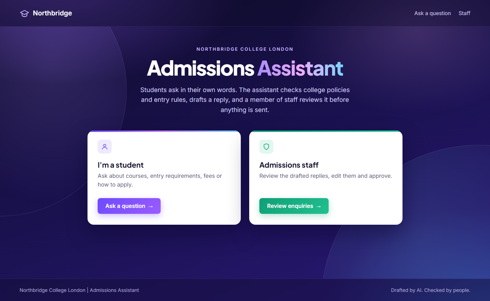
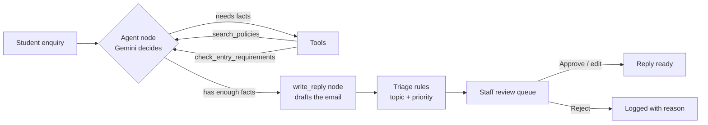
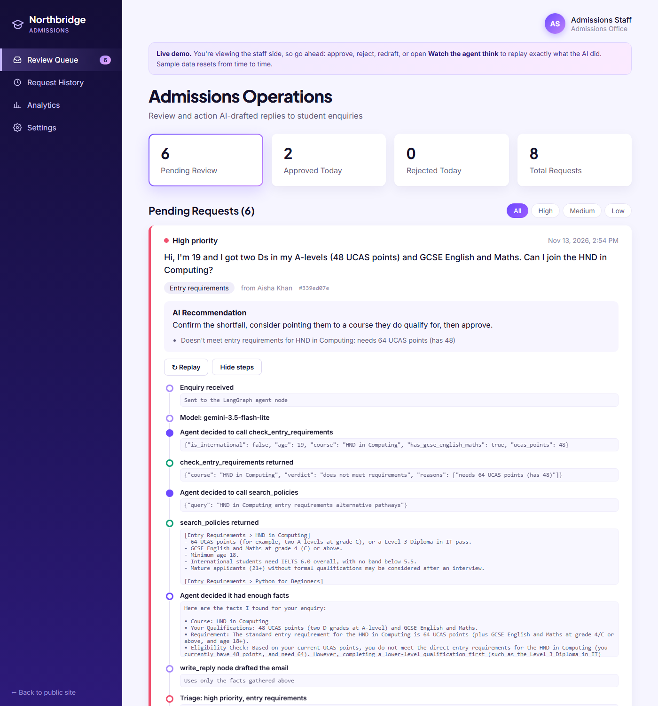
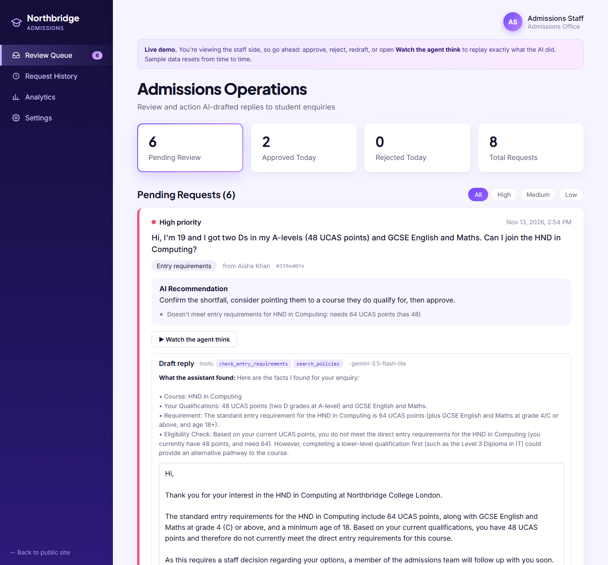
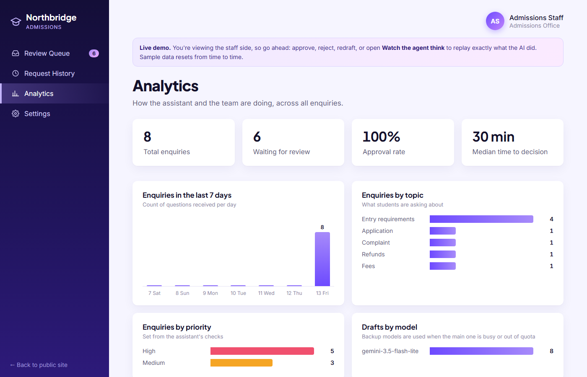
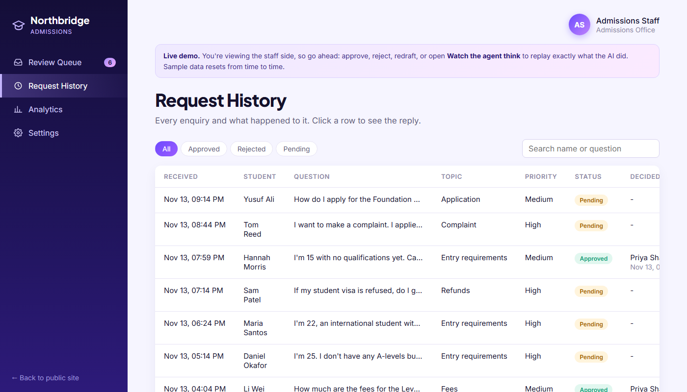
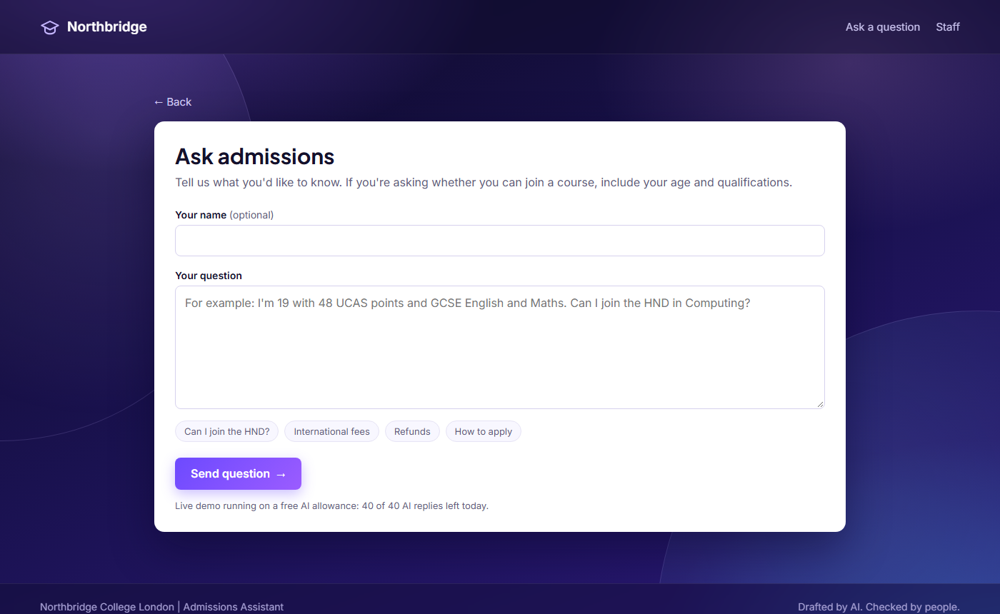

# Admissions Agent: AI Enquiry Assistant with Human Review

An agentic system for **Northbridge College London** (a fictional college) that reads student admissions enquiries written in plain English, looks up the college's real policies, checks eligibility with fixed rules, drafts a reply, triages it by risk, and **pauses for a member of staff to approve it** before anything is sent.

**Live demo:** https://northbridge-admissions-agent.onrender.com




---

## The problem it solves

Admissions teams get the same kinds of messages every day:

- "I'm 19 with 48 UCAS points. Can I join the HND in Computing?"
- "How much are the fees for international students?"
- "If my visa is refused, do I get my £2,000 deposit back?"
- "I applied three weeks ago and nobody has replied. I want to complain."

Each one needs someone to find the right policy, work out whether the student qualifies, write a careful reply, and spot the ones that need a senior decision (refunds, complaints, borderline applicants). This project automates the research and drafting, while keeping a person in charge of what is actually sent.

## How it works



1. **A student asks a question** on the public page, in their own words.
2. **The agent decides what to look up.** A LangGraph graph gives Gemini two tools and lets it choose which to call, with what arguments, and how many times. It loops until it decides it has enough facts.
   - `search_policies`: finds the relevant sections of the college documents in [`docs/`](docs/) (courses, entry requirements, fees and refunds, how to apply).
   - `check_entry_requirements`: **plain Python rules, no AI**. Eligibility is a yes/no decision with consequences, so it must be the same every time and never "hallucinated".
3. **A separate `write_reply` step drafts the email** using *only* the facts gathered, with instructions not to promise offers, refunds or exceptions.
4. **Deterministic triage** sets a topic and a priority from the real tool results, not from the model's opinion:
   - **High:** refunds, complaints, or the eligibility check says the student doesn't qualify or needs an interview
   - **Medium:** international applicants, unknown courses, replies that promise a follow-up, or no documents checked
   - **Low:** simple information questions
5. **A person reviews it.** Nothing goes out automatically. Staff see an AI recommendation (for example "Forward to the Finance Office and make sure the reply doesn't promise a refund"), edit the draft if needed, then approve or reject with a reason.

## Watch the agent think: the step-by-step trace

Every enquiry stores the **real sequence of steps** the agent took: which model answered, every tool it chose to call with its exact arguments, what each tool returned, when it decided it had enough, how the reply was drafted, and why it was given its priority. On the dashboard, **"Watch the agent think"** replays these steps one by one.

This turns an invisible decision process into something a reviewer (or an interviewer watching a demo) can check, rather than just trust.



## Two audiences, one app

| Page | Who it's for | What it does |
|---|---|---|
| `/` | Everyone | Landing page that splits into the two audiences |
| `#/ask` | Students | "Ask admissions" form with example questions |
| `#/staff` | Admissions staff | **Review Queue**: stat cards, priority-sorted requests, AI recommendation, editable draft, approve / reject / redraft, trace replay |
| `#/staff/history` | Admissions staff | **Request History**: searchable table of every enquiry, the final reply, who decided and when |
| `#/staff/analytics` | Admissions staff | **Analytics**: approval rate, median time to decision, enquiries per day, by topic, by priority, by model |
| `#/staff/settings` | Admissions staff | Staff name and role, model fallback order, how priority is decided |

<table>
<tr>
<td></td>
<td></td>
</tr>
<tr>
<td></td>
<td></td>
</tr>
</table>

## Tech stack

| Layer | Choice | Why |
|---|---|---|
| Orchestration | **LangGraph** | A real loop (agent → tools → agent) with a conditional exit, not a fixed pipeline |
| LLM | **Google Gemini** via `langchain-google-genai` | Fast, and has a free tier; Flash-Lite is enough for a narrow task |
| Eligibility | **Plain Python rules** | Decisions that matter must be deterministic and testable |
| Retrieval | Keyword search over Markdown sections | Small, transparent document set; headings weighted double |
| Web server | Python's built-in `http.server` | Zero web-framework dependencies; JSON API plus one static page |
| Frontend | Plain HTML, CSS and JavaScript | No build step; one file, hash routing, responsive down to phone width |
| Storage | JSON file | Right-sized for a demo; easy to inspect |
| Deployment | **Render** (free) via `render.yaml`, or **Docker** | Push to GitHub → auto-deploy |

## Evaluation

Two layers of testing:

**1. Offline tests (no API key needed):** 15 tests covering the eligibility rules, triage priorities, reply clean-up, model-error handling and demo usage limits.

```bash
python -m unittest discover tests
python test_agent_offline.py      # graph wiring with a fake model
```

**2. Live evaluation of the whole pipeline** ([`tests/evaluate_agent.py`](tests/evaluate_agent.py)): 8 realistic enquiries run against real Gemini calls, each checked on:

- **Tools:** did the agent call at least the tools it needs? (A subset check: a sensible extra lookup is not a failure.)
- **Verdict:** is the fixed-rules eligibility verdict the expected one?
- **Triage:** are the topic and priority what staff should see?
- **Facts:** does the drafted email contain the key fact from the college documents (for example "£9,000", "64 UCAS", "IELTS 6.0")?

| Check | Result (gemini-3.5-flash-lite, 13 Nov 2026) |
|---|---|
| Tools | 8 / 8 |
| Eligibility verdict | 4 / 4 |
| Triage | 8 / 8 |
| Facts in reply | 8 / 8 |

This was a single run. LLM output varies between runs, so treat it as a smoke test, not a guarantee. The same run's real outputs are what the public demo loads as sample data (`python tests/evaluate_agent.py --seed`).

## Real engineering problems hit and fixed

- **"503 UNAVAILABLE: model is experiencing high demand."** The configured model was overloaded. Wrote a probe script ([`find_model.py`](find_model.py)) to test which models actually respond right now, then built **automatic model fallback**: the app tries the main model, then a list of backups, and records the switch in the trace.
- **"429 RESOURCE_EXHAUSTED": the free daily quota ran out** after a few test runs, because each enquiry costs 3–5 model calls. Fallback now treats quota, overload, timeouts and retired models as "try the next model", but treats a bad API key as a real error, since switching models wouldn't help. Users see a plain-English message instead of a raw Google error.
- **A model was retired (404 NOT_FOUND)** for new users. The original default model in the code stopped existing, which is another reason fallback lists beat a single hard-coded model.
- **The reply printed as a Python list with a long "signature" code.** Newer Gemini models return content as a list of parts (text plus a reasoning signature), not a string. The app extracts only the text parts.
- **Markdown leaked into emails.** The model wrote `**bold**` and `* bullets`, which look broken in a plain-text email. Replies are cleaned to plain text with `•` bullets.
- **The model ignores `temperature`** on some newer models and warns on every call. The warning is filtered, and nothing relies on temperature for correctness, because the decisions that matter are made by fixed rules.
- **Auto-refresh wiped a reviewer's edits.** The queue polls for new drafts every few seconds and re-rendered the card being edited. Polling now pauses while a text box has focus.
- **Priority was first guessed from keywords.** It now comes from the actual `check_entry_requirements` verdict, so "doesn't meet requirements: needs IELTS 6.0 (has 5.5)" shows up as a precise, explainable reason.
- **The evaluation found a triage gap:** "If my visa is refused, do I get my £2,000 deposit back?" was classed as *Fees / medium* instead of *Refunds / high*. Fixed by adding the wording to the refund rules, which the evaluation now covers.
- **The dashboard overflowed on phones.** A CSS grid column sized to its content (`1fr`) let wide content push the page sideways. Fixed with `minmax(0, 1fr)`, then checked with screenshots at phone width.

## Running it publicly on a free API key

A public link means strangers spend your Gemini quota. With `DEMO_MODE=1` the app:

- limits AI drafts per day (`DAILY_LIMIT`, default 40) and per visitor per hour (`VISITOR_LIMIT_PER_HOUR`, default 5), with a friendly message when a limit is hit
- loads 8 real sample enquiries on first start, so the dashboard is never empty, even when the quota is used up
- shows a "Live demo" banner on the staff side, inviting visitors to approve, reject and replay traces

## Known limitations

- **No login.** The staff dashboard is open to anyone. That's deliberate for a portfolio demo, but real staff pages would need authentication.
- **Nothing is emailed.** "Approve" marks a reply as ready; it doesn't send it.
- **JSON-file storage.** On free hosting, the file resets when the service restarts, so the demo re-seeds itself. Production would use a database.
- **Usage limits are kept in memory**, so they reset on restart.
- **Retrieval is keyword-based.** It works for four short documents; a bigger knowledge base would need embeddings.
- **Run-to-run variation.** The agent may choose a different (still reasonable) set of tool calls each time. That's why the trace exists and why a person approves every reply.

## API endpoints

| Method | Endpoint | Purpose |
|---|---|---|
| GET | `/` | The web app (landing page, student form, staff dashboard) |
| GET | `/health` | Health check (used by the host) |
| GET | `/api/info` | Model list, demo mode, remaining demo quota |
| GET | `/api/enquiries` | All enquiries with drafts, triage and trace |
| POST | `/api/enquiries` | Submit a question (`{"name", "question"}`); the agent drafts in the background |
| POST | `/api/enquiries/{id}/approve` | Approve (with the final edited draft) |
| POST | `/api/enquiries/{id}/reject` | Reject (with an optional reason) |
| POST | `/api/enquiries/{id}/save` | Save edits to a draft |
| POST | `/api/enquiries/{id}/retry` | Ask the agent to draft again |

## Project structure

```
admissions-agent/
  agent.py               LangGraph agent: tools, state, agent node, write_reply node
  tools.py               search_policies (keyword retrieval) + check_entry_requirements (fixed rules)
  app.py                 web server, JSON API, model fallback, triage, trace, demo limits
  web/index.html         the whole frontend: landing, student form, staff dashboard
  docs/                  the college's policy documents the agent searches
  demo_seed.json         real evaluation output used as demo sample data
  find_model.py          checks which Gemini models are available right now
  test_agent_offline.py  graph wiring test with a fake model
  tests/
    test_triage.py       offline unit tests
    evaluate_agent.py    live end-to-end evaluation
  screenshots/           images used in this README
  Dockerfile, render.yaml, requirements.txt, .env.example
```

## Running locally

```bash
git clone https://github.com/<your-username>/admissions-agent.git
cd admissions-agent
python -m venv venv
venv\Scripts\activate            # Windows   (macOS/Linux: source venv/bin/activate)
pip install -r requirements.txt
copy .env.example .env           # macOS/Linux: cp .env.example .env
```

Put your free Gemini API key (from [Google AI Studio](https://aistudio.google.com/apikey)) in `.env`, then:

```bash
python app.py
```

Open http://127.0.0.1:8000. Run `python agent.py` for a single answer in the terminal, or `python find_model.py` to see which models are available on your key.

## Deployment (free, on Render)

1. Push this repository to GitHub (`.env` is in `.gitignore`, so your key stays private).
2. On [render.com](https://render.com), sign in with GitHub and choose **New → Blueprint**, then pick this repository. Render reads [`render.yaml`](render.yaml).
3. When asked, paste your `GOOGLE_API_KEY`. Everything else is preset (demo mode on, Flash-Lite first).
4. Deploy, then put the `onrender.com` link at the top of this README and on your CV.

Free Render services sleep after about 15 minutes without visitors and take about a minute to wake up. Docker also works anywhere: `docker build -t admissions-agent .` then `docker run -p 8000:8000 --env-file .env admissions-agent`.

## Author

_Neelam Fatima_: built as an AI engineering portfolio project. _(https://www.linkedin.com/in/neelam-fatimah/) / (https://github.com/neellam-arch/Rayners-College-RAG-)_
